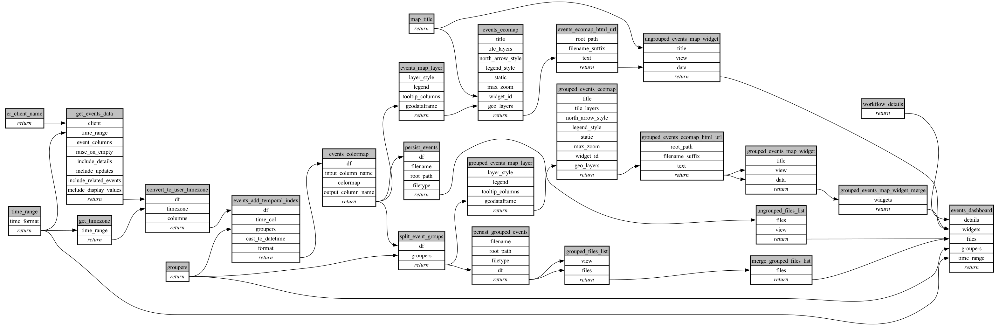

```
# AUTOGENERATED BY ECOSCOPE-WORKFLOWS; see fingerprint in README.md for details

```

```yaml
# fingerprint:
artifacts_sha256_basic: 6b4b860b01d0c3b93ca1031c3bb50198120a5060d1151c58144ed493dc89fdbf
artifacts_sha256_strict: 8c1bfc43506a3ae329f08a1cb97009538c23108c130eb687fe59a56a55e429da
installed_requirements:
- channel: https://repo.prefix.dev/ecoscope-workflows/
  name: ecoscope-platform
  version: {version: ==2.31.0}
- channel: conda-forge
  name: pydeck
  version: {version: ==0.9.2}
params_sha256: aa285d771d77a3a1841645130083213c94d8553c141c7492dd60f2a041b3d1fb
spec_sha256: d6ba6775f6ba437c6d6a1c8115e3c71d42e3717bf35268b8e805cb7fd1e0e6d6

```

# ecoscope-workflows-test-dashboard-workflow



